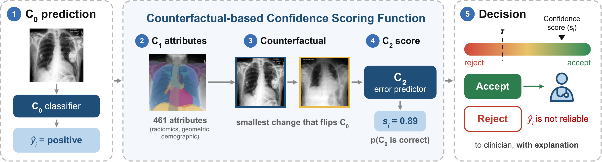

# Confidence is Not Enough: Exploring Counterfactuals for Selective Classification in Medical Imaging

Code for the MSc thesis in Biomedical Engineering by **João Maria Apolónia da Mata**
(Instituto Superior Técnico, November 2026).
Supervisors: Dr. Joris Fournel and Prof. Ana Catarina Fidalgo Barata.

> Chest X-ray classifiers sometimes make predictions that are wrong but confident.
> Selective classification gives a classifier a reject option, so it can abstain on
> predictions likely to be wrong. This thesis asks whether **counterfactual
> explanations** (the smallest change to an image that flips the classifier's
> prediction) can show when a prediction is wrong, and explain why.

## Summary

For a fixed DenseNet-121 trained on the five CheXpert competition findings (atelectasis,
cardiomegaly, consolidation, edema, pleural effusion), we:

1. **retrieved** counterfactuals as nearest unlike neighbours in a 461-dimensional
   anatomical attribute space, and **generated** them with classifier-guided diffusion;
2. trained confidence scoring functions on the attribute changes, on image and saliency-map
   pairs, and on the diffusion trajectory, then ensembled them;
3. benchmarked the ensemble against ConfidNet, TrustScore, SC-CE and a threshold-adjusted
   maximum softmax probability (ad-MSP);
4. clustered the predictions in the ensemble's embedding space to explain which
   predictions get rejected and why.

**Key findings**

- On every finding, counterfactuals added correctness signal beyond what the input image
  alone provides. At equal training size, generated counterfactuals carried more signal
  than retrieved ones.
- Most of that signal is already in the classifier's own confidence. Our ensemble is the
  only method tested that beats ad-MSP on average (+0.003 AUROC). The gain is significant
  on three of the five findings. It held for a ResNet-50 classifier, and partly for a
  ViT-B/16.
- The value of counterfactuals lies mainly in explanation. For example, clusters of
  positive cardiomegaly predictions range from 35% to 78% wrong:
  - In the most trusted cluster, hearts are enlarged and the counterfactual shrinks them.
  - In the least trusted cluster, hearts look normal and the counterfactual barely
    changes them.

## Method



| Component | Role | Main code |
|---|---|---|
| **C0**: base classifier | 14-label DenseNet-121 (also ResNet-50, ViT-B/16), U-Ignore uncertainty policy, frozen after training | `c0_train_multilabel_final.py`, `c0_final_predictions.py`, `c0_arch.py` |
| **C1**: attribute extractor | 461 attributes per image: demographics, per-organ geometry, shape and first-order radiomics on 14 structures segmented with TorchXRayVision's ChestX-Det PSPNet, plus clinical ratios | `c1_build_attribute_vector_subset.py` (wraps `code/c1/c1_build_attribute_vector.py`), `c1_assemble_c2_attributes.py` |
| **Counterfactuals**: retrieved | K nearest unlike neighbours (L1 distance on standardised attributes), searched only within the training folds | `c2_folds.py`, `c2_cf_sources.py` |
| **Counterfactuals**: generated | FastDiME classifier-guided diffusion, graded targets (low / mid / high) | `cf_generation_final.py`, `cf_generate_levels.py`, `cf_levels_*.py` |
| **C2**: confidence scoring function | Attribute MLPs, image / saliency CNNs, diffusion-trajectory models, cross-family ensembles | `c2_train_attributes.py`, `c2_train_images.py`, `c2_train_trajectory.py`, `c2_ensemble.py`, `c2_derive_k.py` |
| **Baselines** | MSP and ad-MSP, ConfidNet, TrustScore, SC-CE | `c2_msp.py`, `c2_confidnet*.py`, `c2_trustscore*.py`, `c2_scce*.py` |
| **Explainability** | Embeddings of the C2 models, failure groups, per-organ saliency attributes, case cards | `c2_embed_attributes.py`, `c2_embed_images.py`, `c2_saliency_attributes.py` |

All paths are relative to `final_experiment/code/`.

**Data split.** CheXpert-v1.0-small, frontal views only, split by patient:

- One half trains C0 (85,664 images) and selects its checkpoint and threshold (9,528 images).
- C0 then predicts the other half (95,835 images), which it never saw in training.
  Comparing those predictions with the labels gives the error-detection dataset: C2's
  target is whether C0 was correct, not the finding itself.
- C2 is evaluated with 5-fold, patient-grouped cross-validation.

## Repository layout

```
final_experiment/        everything used in the thesis (start here)
├── code/                pipeline scripts (C0 → C1 → counterfactuals → C2 → baselines → explainability)
├── jobs/                LSF batch scripts that run each stage on the DTU HPC cluster
├── *.ipynb              analysis notebooks that produce the thesis figures and tables
├── figures/             thesis figures (c0/, c2/, c2_key/, xai_key/, diffusion/, ...)
├── tables/              LaTeX tables included in the thesis
├── results/             small result files; large outputs are symlinks to cluster storage
├── demo/                static HTML viewer of example cases (open demo/index.html)
├── C0_train.csv, C0_checkpoint_selection.csv, C2_dataset.csv, Original_Test.csv
│                        the patient-level split definitions
└── README.md            detailed technical notes on the pipeline and its design decisions
code/                    earlier development code; final_experiment still imports a few
                         shared modules from here (code/c1, code/c2)
notebooks/               exploratory notebooks from earlier phases (not used in the thesis)
```

### Notebooks by thesis section

| Thesis section | Notebook(s) |
|---|---|
| Data split and C0 | `C0_custom_split.ipynb`, `c0_analyse_predictions.ipynb`, `arch_comparison.ipynb` |
| Aim 1: correctness signal | `C2_evaluation.ipynb`, `C2_evaluation_diffusion.ipynb`, `diffusion_experiments.ipynb`, `trajectory_fingerprint.ipynb`, `cf_distance.ipynb`, `SubsetsC2.ipynb` |
| Aim 2: baselines and significance | `bootstrapping.ipynb`, `bootstrapping_diffusion.ipynb`, `errors_at_coverage.ipynb`, `TABLES.ipynb` |
| Aim 3: explanations | `attribute_explainability.ipynb`, `saliency_explainability.ipynb`, `case_card_combined.ipynb` |
| Supplementary | `subgroup_performance.ipynb`, `stratified_performance.ipynb`, `cf_parameters.ipynb` |

## Reproducing

### Environment

Python 3.9. The main packages and the versions used are in `requirements.txt`:

```bash
python -m venv thesis_env && source thesis_env/bin/activate
pip install -r requirements.txt
```

Diffusion counterfactuals also need the
[FastDiME_Med](https://github.com/nina-weng/FastDiME_Med) repository and its pretrained
CheXpert DDPM, cloned into `FastDiME_Med/` at the repository root (gitignored here).

### Data

Download CheXpert-v1.0-small (Stanford AIMI / Kaggle), then point the code at it:

```bash
export THESIS_DATA=/path/to/data              # folder containing CheXpert-v1.0-small/
export THESIS_RESULTS=/path/to/results        # where models and predictions are written
```

The split CSVs in `final_experiment/` fix which images go to C0 and which to C2.

### Running the pipeline

Each stage has an LSF job in `final_experiment/jobs/` (pass `-env "all"` so variables such as
`DISEASE` reach the job). The comment at the top of each job
script explains its inputs and options. The order is:

```bash
bsub -env "all" < final_experiment/jobs/train_c0_multilabel_final.sh          # 1. train C0 (once)
bsub -env "all" < final_experiment/jobs/build_c1_c2_dataset.sh                # 2. C1 attributes (once)
DISEASE=effusion bsub -env "all" < final_experiment/jobs/run_disease.sh       # 3. C0 predictions + C2 dataset
./final_experiment/jobs/submit_chain.sh effusion                   # 4. folds/CFs → C2 models → ensemble
DISEASE=effusion bsub -env "all" < final_experiment/jobs/cf_levels.sh         # (optional) diffusion counterfactuals
./final_experiment/jobs/submit_confidnet.sh                        # 5. baselines (also trustscore, scce)
```

Then run the notebooks listed above to produce the figures and tables.
`final_experiment/README.md` documents the design decisions in detail: uncertainty
policy, leakage guards, how K counterfactuals are ensembled, and cost control.

> **Note:** the job scripts were written for the DTU HPC (LSF) cluster. They contain
> absolute paths (`/zhome/...`, `/work3/...`), a cluster-specific virtualenv and an email
> address, which you must adapt. Large outputs (model checkpoints, generated
> counterfactuals, per-fold predictions, the full XAI case-card set) are not in the
> repository; the code to regenerate them is.

## Citation

```bibtex
@mastersthesis{mata2026confidence,
  title  = {Confidence is Not Enough: Exploring Counterfactuals for Selective
            Classification in Medical Imaging},
  author = {Mata, Jo{\~a}o Maria Apol{\'o}nia da},
  school = {Instituto Superior T{\'e}cnico, Universidade de Lisboa},
  year   = {2026}
}
```

## Acknowledgements

This work builds on [CheXpert](https://stanfordmlgroup.github.io/competitions/chexpert/),
[TorchXRayVision](https://github.com/mlmed/torchxrayvision) and
[FastDiME](https://github.com/nina-weng/FastDiME_Med).
